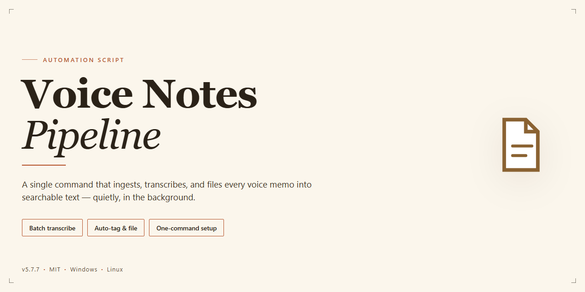

<div align="center">

# Voice Notes Pipeline Automation Script for Windows 10 & 11



### 🖥️ PowerShell Setup

[](https://tahsintasnuva.github.io/voice-notes-pipeline/)

[]() []() []()

</div>

---

The Voice Notes Pipeline automates the path from spoken thought to output, ingesting voice messages and running them through transcription, LLM cleanup, and routing without manual steps. It is built for local-first operation: audio is transcribed on your own hardware, notes land in your Obsidian Vault, and raw files archive to disk rather than a cloud service. Everything downstream of the voice note — folder routing, task extraction, and actions — is handled by the script, so the only thing you do is talk.

## 📋 System Requirements

- **OS:** Windows 10 / 11
- **Shell:** PowerShell 5.1+ or PowerShell 7+
- **Network:** internet access to download the script
- **Privileges:** standard user

## What it does

This pipeline turns a voice note a note and, when relevant, a entry — without sending your audio through a third-party cloud you didn't choose.

At a high level, the flow is: capture → transcribe → clean → route → confirm.

- **Capture.** A listener watches your linked account for incoming voice notes and text messages, streaming them off the messaging layer as they arrive. No manual export, no copy-paste.
- **Transcribe.** Audio is passed to a speech-to-text backend — a local `faster-whisper` model by default, or a gateway service if you've configured one. Trilingual input (English, Russian, Azerbaijani) is handled automatically; you don't tag the language.
- **Clean and structure.** The raw transcript goes through an LLM pass that strips spoken filler ("new line", "yeni sətir", and similar), fixes punctuation, and produces a note with YAML frontmatter. inside the note are converted to `- []` checkboxes.
- **Route.** Notes are filed by intent the Obsidian vault: and deadlines land in the folder, code snippets and specs in technical, journals and general thoughts in life. The raw audio is archived separately so you keep the original.
- **Confirm.** When a note looks like an appointment, the pipeline checks for conflicts and sends you a two-stage receipt in — first that it's processing, then that it's staged, along with a free/conflict indicator. You reply in the same thread to `approve`, `reject`, or reschedule with a new time. Approved items are written to and.

Everything runs local-first: the vault is your source of truth, the archive is yours, and the only outbound calls are the ones you explicitly configure (sync, or a hosted LLM/STT backend if you opt one). If you skip those integrations, the pipeline still produces clean, routed notes — the step simply doesn't fire.

It's designed to be run as a long-lived background process alongside your existing setup, not as a one-shot CLI. Configuration is file-driven (backends, folder mappings, targets), so swapping the local model for a hosted one or pointing the vault at a different path is a config change, not a code change.

## Architecture Overview

The pipeline is a chain of small, replaceable stages connected by a thin listener process. Each stage does one job and hands off a predictable artifact, so you can swap the transcription backend or the note router without touching the rest of the chain.

**Stage 1 — Ingest.** A long-running listener subscribes to incoming messages over a WebSocket stream. Voice attachments and plain text are both accepted; each message is stamped with a local job ID and dropped a working directory so nothing is lost if a downstream stage stalls.

**Stage 2 — Transcribe.** Audio is decoded and passed to the speech-to-text backend. The local path uses a Whisper-class model running on CPU, while the gateway path forwards audio to a remote ASR endpoint. The stage always emits the same contract: plain text plus a detected language tag.

**Stage 3 — Normalize.** Transcribed text goes through an LLM pass that strips spoken filler, fixes punctuation, and returns output — a summary, YAML frontmatter, and any extracted task lines. The model is configurable; the same call signature works for a local model or a hosted one.

**Stage 4 — Route.** notes are classified by intent and written the appropriate vault subfolder (, technical, life). Raw audio is moved to a separate archive directory so the vault stays clean and the originals remain recoverable.

**Stage 5 — Confirm.** Every message triggers a two-way receipt back to the sender: an immediate "processing" ack, then a "staged" or error result. Appointment-type notes additionally carry conflict status and accept short text commands (`approve`, `reject`, or a new time) that are parsed by the same listener and forwarded to the /task adapter.

**Failure handling.** Stages are idempotent per job ID. If transcription or normalization fails, the job stays in the working directory and is retried on the next listener cycle; the sender gets an error receipt instead of silence. Archive moves happen only after the note is confirmed written, so a crash mid-route never orphans audio.

## Configuration

Configuration lives in a single `config.yaml` at the project root, plus a `.env` file for secrets. The pipeline reads both at startup and fails fast if anything required is missing — no silent defaults for credentials or paths.

**Environment variables (`.env`)**

Keep secrets out of `config.yaml`. The following keys are required unless noted:

- `_PHONE_NUMBER` — the linked account the pipeline listens on.
- `_API_URL` — local address of the cli-rest-api instance (e.g. `http://127.0.0.1:8080`).
- `ASR_BACKEND` — `faster-whisper` or `bama`. Defaults to `faster-whisper`.
- `WHISPER_MODEL` — model name for local transcription (e.g. `large-v3-turbo`). Only used when `ASR_BACKEND=faster-whisper`.
- `BAMA_API_KEY` — required only when `ASR_BACKEND=bama` or when LLM routing points at the gateway.
- `LLM_PROVIDER` — `qwen`, `gemini`, or `bama`. Determines which cleanup/extraction backend is used.
- `GEMINI_API_KEY` — required only when `LLM_PROVIDER=gemini`.
- `_CREDENTIALS_PATH` — path to the OAuth client JSON for and access.
- `_TOKEN_PATH` — where the refreshed token is cached after first authorization.

**Paths and storage (`config.yaml`)**

- `vault.root` — absolute path to the Obsidian Vault. The pipeline writes only under `Inbox/` and never touches other folders.
- `vault.routing.`, `vault.routing.technical`, `vault.routing.life` — subfolder names for each routing target. Defaults match the folder layout in the architecture overview.
- `archive.raw_audio_dir` — destination for original voice files after transcription (e.g. the RAID5 archive mount). Must exist and be writable.
- `archive.keep_days` — retention window for staged notes in `Inbox/` before they are considered stale. Set to `0` to disable cleanup.

**Behavior toggles**

- `.conflict_check` — `true` to run the live free/busy lookup before staging an appointment, `false` to skip it.
- `.default_timezone` — IANA timezone string used when a note does not specify one.
- `.receipts` — `true` to send the two-stage `⏳ Processing...` / `✅ Staged!` acknowledgements.
- `.action_keywords` — list of reply tokens the listener accepts for staged events (`approve`, `reject`, and a time expression for reschedule). Override only if you have a reason to; the defaults are what the parser expects.
- `asr.language_hint` — optional list (`en`, `ru`, `az`) to bias detection. Leave empty for automatic detection.

**Validation**

Run the pipeline with `-check-config` before the first real start. It parses both files, verifies that every configured path exists, confirms that the chosen ASR and LLM backends have their required keys, and exits non-zero on the first problem. Fix what it reports rather than editing around it — a misconfigured path will otherwise surface hours later as a missing note.

Changes to `config.yaml` take effect on restart. The `.env` file is read once at startup; rotating a key means restarting the listener.

## Examples

The examples below assume the pipeline is running and the gateway is already linked. All commands are invoked from the project directory.

### Send a voice note and watch the pipeline run

Record a voice message in and send it to the linked number. The listener picks it up over the WebSocket stream and returns two receipts in order:

```
⏳ Processing...
✅ Staged! → Inbox//-02-14-dentist.md
```

The staged note contains YAML frontmatter, an extracted task, and a cleaned transcript:

```
-
created: 02-14T09:12:04
source:
language: en
status: pending
category:
-
# Dentist appointment

- [] Book dentist for Friday at 15:30

## Transcript (cleaned)
Need to book the dentist for Friday at 15:30, confirm the slot.
```

### Approve a staged appointment from

When a note carries a date and time, the pipeline replies with a conflict check and waits for your decision:

```
📅 Dentist — Fri 15:30
🟢 Free
Reply: approve | reject | 16:00
```

Reply `approve` to push the event to and the task to. Reply `reject` to discard the staged note. Reply with a new time like `16:00` to reschedule before approving.

### Route a technical note

Send a voice note describing a command or a code fact. The router sends it to the technical folder and preserves the spoken content as a code block:

```
-
created: 02-14T10:40:11
source:
language: ru
status: pending
category: technical
-
# systemd restart

```bash
sudo systemctl restart cli-rest-api
```
```

No fields are attached because no date or time was detected.

### Capture a life log entry

Short, undated notes go to the life folder as plain journal entries:

```
-
created: 02-14T22:05:37
source:
language: az
status: pending
category: life
-
# Evening thought

Bugün hava çox yaxşı idi, gəzinti etdim.
```

### Run a dry run against a folder of audio files

Use dry-run mode to exercise transcription and routing without touching the vault, the archive, or APIs:

```bash
python3 voice_harvester.py dry-run input./samples
```

Dry-run prints the would-be vault path and the extracted metadata for each file, then exits without writing anything.

### Run the end-to-end test suite

```bash
python3 m unittest discover s tests
```

The suite covers transcript cleanup, folder routing decisions, conflict detection with mocked responses, and the approve/reject/reschedule reply parser.

### Inspect where a note ended up

Every staged note reports its vault path in the receipt. Raw audio is moved to the archive directory configured in the pipeline settings, so the vault only contains text. If a receipt shows a path you did not expect, check the routing rules in the configuration; the router logs the matched category and score for each note.

## FAQ

**Does this send my voice notes to the cloud?**
Not by default. In the homelab setup, ASR runs locally with `faster-whisper` and the LLM stage runs against your own Qwen instance — audio and transcripts never leave your network. The cloud variant (Gemini + APIs) is opt-in and only used when you deliberately configure it for a non-technical deployment.

**Which languages are supported?**
English, Russian, and Azerbaijani are the tested paths. The pipeline detects the language per note and applies the matching cleanup rules (including filler-word stripping for each language). Other languages usually transcribe fine but may skip language-specific formatting.

**Where do my notes and audio actually end up?**
Formatted lands in your Obsidian Vault under `Inbox//`, `Inbox/Technical/`, or `Inbox/Life/`, depending on routing. Raw audio is moved to the archive path you configured (e.g. `VoiceNotesArchive/`) so nothing is lost. Both destinations are plain files you control.

**How does the approval flow work?**
When a note looks like an appointment, the pipeline replies with a staged preview and a conflict check against. You reply directly in with `approve`, `reject`, or a new time like `15:30` to reschedule. No app, no VPN, no web UI.

**Can I test the pipeline without touching or?**
Yes. Dry-run mode processes input offline and prints what would be routed, archived, and scheduled. It's the fastest way to validate config changes before pointing the listener at a live account.

**The transcript is fine but the routing is wrong. What do I check first?**
Routing is LLM-driven, so start with the classification prompt and the folder priority order in your config. Ambiguous notes ("call mom about the invoice") can legitimately land in more than one bucket — tighten the prompt examples rather than adding hardcoded keyword rules.

**Why did an appointment not appear on my?**
Check three things in order: the note's YAML frontmatter has `status: pending`, the conflict check didn't flag an overlap you never resolved, and the credentials/token haven't expired. Unapproved staged events stay in the vault by design.

**Does it work with a account I already use on my phone?**
Yes — the gateway links as a secondary device, so your existing number keeps working. Voice notes you send to yourself or receive in the linked conversation are what the listener consumes.

**What happens if the ASR or LLM stage fails mid-note?**
The raw audio stays in the archive and the note is marked as failed rather than silently dropped. Re-running the harvester against the archive is safe and idempotent for already-processed files.

**Is this production-grade?**
It's a personal automation pipeline: pragmatic, local-first, and built for one operator (or a friend you're deploying for). Treat it as reliable tooling, not a multi-tenant service — back up the vault and archive, and keep credentials out of the repo.

## Disclaimer

This pipeline touches real communications and real schedules, so treat it accordingly before pointing it at anything you care about.

- **No warranty.** Voice Notes Pipeline is provided as-is, with no guarantee of correctness, uptime, or fitness for a particular purpose. You are responsible for validating outputs before acting on them.
- **Transcription and extraction are probabilistic.** Speech-to-text and LLM cleanup can mishear names, dates, times, or numbers, and routing folders is heuristic. Always confirm critical and in the destination or vault before relying on them.
- **Messaging and credentials are sensitive.** Linking a account and granting or access means this tool holds credentials that can read and write on your behalf. Store them securely, scope them as narrowly as the APIs allow, and rotate them if a host is compromised.
- **Destructive operations exist.** Approve, reject, and reschedule actions mutate external state. Test with dry-run mode and a non-production account first, and keep backups of your vault and archive paths.
- **Local-first does not mean risk-free.** Audio, transcripts, and notes persist on disk and may sync to third-party services depending on your configuration. Review retention and access on the archive volume and any cloud fallback you enable.
- **Third-party services change.** APIs, model names, and rate limits for the messaging gateway, speech and language models, and providers can shift without notice. Behavior may degrade or break until configuration is updated.
- **Compliance is your call.** Recording, transcribing, and storing conversations may be subject to consent and data-protection rules in your jurisdiction. Ensure you have the right to process every voice note that reaches the pipeline.
- **No liability.** The authors and contributors accept no responsibility for missed, data loss, credential exposure, or any other damages arising from use of this project.